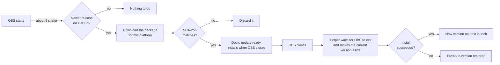

<div align="center">

# 📡 OBS Multi Stream

**Stream one OBS session to many platforms at once — each from the main mix or its own vertical canvas.**

[](https://github.com/alejox/multi-streaming/releases/latest)
[](https://github.com/alejox/multi-streaming/releases)
[](LICENSE)
[](#-installation)
[](https://obsproject.com)

[Español](README.md) | **English**

[⬇️ Download](https://github.com/alejox/multi-streaming/releases/latest) ·
[🧰 Install](#-installation) ·
[✨ Features](#-whats-included) ·
[❓ FAQ](#-faq-and-troubleshooting)

</div>

---

## ✨ What's included

| | Feature | What it does |
|:-:|---------|--------------|
| 🌐 | **Multi-destination streaming** | Many RTMP/RTMPS destinations, each with its own start/stop, plus **Start all** and **Stop all** |
| 🎯 | **Service presets** | YouTube, Twitch, Kick, Facebook, TikTok, X, Instagram, or a custom server. Links to the stream key page for YouTube, Twitch, Kick and Facebook |
| 📱 | **Vertical canvas** | A second canvas (default 1080x1920) with its own scenes, sources, preview, and Fit/Fill composition, in its own dock |
| 🎞️ | **Video source per destination** | Each destination sends the `main` mix or the `vertical` canvas |
| ⚙️ | **Smart encoders** | Destinations share an encoder when their settings match, and get a dedicated one when they don't |
| 🔗 | **Sync with OBS streaming** | Optionally start and stop a destination together with the main OBS stream |
| 🟣 | **Connect with Twitch** | Log in through the browser (OAuth); the stream key is filled in and the session is remembered |
| 🔁 | **Auto-reconnect** | Per-destination retry count and first delay, with a "next try in N s" countdown |
| 📊 | **Live stats** | On-air time, bitrate, and dropped frames per destination, with an "unstable" warning for flapping connections |
| 🛡️ | **Failure isolation** | A failing destination never stops the others or the main stream |
| 🔐 | **Secure key storage** | Keys live in macOS Keychain, Windows Credential Manager, or Linux Secret Service — never in config files |
| 🔄 | **Automatic updates** | New versions download in the background, are verified with SHA-256, and install when OBS closes |
| 🌍 | **Translations** | Full UI in English and Spanish |
| 🎨 | **Native look** | Follows the OBS theme, with an optional **Color icons** mode for brand-colored platform icons |

---

## 🧰 Installation

> [!IMPORTANT]
> **Close OBS before installing.** OBS cannot replace a plugin it has loaded.

| Platform | Package | Built against |
|----------|---------|---------------|
| 🍎 macOS (Apple Silicon) | `obs-multi-stream-<version>-macos-arm64.zip` | OBS 33.0.1 |
| 🪟 Windows x64 | `obs-multi-stream-<version>-windows-x64.zip` | OBS 33.0.1 |
| 🐧 Linux x86_64 | `obs-multi-stream-<version>-linux-x86_64.tar.gz` | OBS from the Ubuntu 24.04 PPA (32.2.0 at the time of writing) |

All packages are on the [latest release page](https://github.com/alejox/multi-streaming/releases/latest). The Windows and Linux packages also contain their install steps as `INSTALL.txt`.

<details>
<summary><b>🍎 macOS (Apple Silicon, arm64)</b></summary>

<br>

1. Download `obs-multi-stream-<version>-macos-arm64.zip` from the [latest release](https://github.com/alejox/multi-streaming/releases/latest) and unzip it.
2. Copy the `obs-multi-stream.plugin` bundle into:

   ```text
   ~/Library/Application Support/obs-studio/plugins/
   ```

   In Finder, press <kbd>⌘</kbd> <kbd>⇧</kbd> <kbd>G</kbd> and paste the path. Create the `plugins` folder if it does not exist.
3. Open OBS and check [that it loaded](#-check-that-it-loaded).

> [!WARNING]
> **The macOS package is ad-hoc signed and not notarized.** Gatekeeper may quarantine it after download. If macOS refuses to load it, clear the flag:
>
> ```bash
> xattr -dr com.apple.quarantine ~/Library/Application\ Support/obs-studio/plugins/obs-multi-stream.plugin
> ```

**Uninstall:** delete `~/Library/Application Support/obs-studio/plugins/obs-multi-stream.plugin`. See [Uninstall](#-uninstall) for the data it leaves behind.

</details>

<details>
<summary><b>🪟 Windows (x64)</b></summary>

<br>

1. Download `obs-multi-stream-<version>-windows-x64.zip` from the [latest release](https://github.com/alejox/multi-streaming/releases/latest).
2. Extract the `obs-multi-stream` folder into:

   ```text
   C:\ProgramData\obs-studio\plugins\
   ```

   The result is `C:\ProgramData\obs-studio\plugins\obs-multi-stream\`.
3. Open OBS and check [that it loaded](#-check-that-it-loaded).

> [!NOTE]
> **Windows needs OBS 33 or later.** OBS refuses a plugin built against a newer libobs than its own.

**Uninstall:** delete `C:\ProgramData\obs-studio\plugins\obs-multi-stream\`. See [Uninstall](#-uninstall) for the data it leaves behind.

</details>

<details>
<summary><b>🐧 Linux (x86_64)</b></summary>

<br>

1. Download `obs-multi-stream-<version>-linux-x86_64.tar.gz` from the [latest release](https://github.com/alejox/multi-streaming/releases/latest).
2. Extract it into your per-user plugin folder:

   ```bash
   mkdir -p ~/.config/obs-studio/plugins
   tar -xzf obs-multi-stream-<version>-linux-x86_64.tar.gz -C ~/.config/obs-studio/plugins
   ```

3. Open OBS and check [that it loaded](#-check-that-it-loaded).

| Requirement | Why |
|-------------|-----|
| glibc 2.39 and Qt 6.4 or later (as on Ubuntu 24.04) | The package is built on Ubuntu 24.04 |
| `libsecret` plus a running Secret Service (GNOME Keyring or KWallet) | Without one, stream keys cannot be saved. They are never kept in plain text |

> [!NOTE]
> The OBS Project PPA has no OBS 33 for Ubuntu 24.04, so the Linux package is built against the OBS version the PPA ships. See [Known limits](#-known-limits).

**Uninstall:** delete `~/.config/obs-studio/plugins/obs-multi-stream/`. See [Uninstall](#-uninstall) for the data it leaves behind.

</details>

### ✅ Check that it loaded

| Where | What you should see |
|-------|---------------------|
| **Docks** menu | **Multi Stream** and **Vertical canvas** entries |
| **Help > Log Files > View Current Log** | A line containing `[obs-multi-stream] loaded version` |

> [!CAUTION]
> **The first load changes your scene collection.** The plugin adds a canvas named `obs-multi-stream-vertical`, and removing the plugin does not remove it. See [Uninstall](#-uninstall).

---

## 🚀 Quick start

Your first multistream in three steps:

1. **Add a destination.** Open **Docks > Multi Stream**, click **Add destination**, pick a service, and paste the stream key (or click **Connect with Twitch**).
2. **Choose the video.** Set **Video source** to `main`, or to `vertical` and arrange that canvas in **Docks > Vertical canvas**.
3. **Go live.** Press the row's start button or **Start all**. To follow the main stream, turn on **Start and stop with OBS streaming** in the destination.

> [!TIP]
> Audio always comes from the main mix. A source added only to the vertical canvas is silent on every destination, which keeps vertical-only audio out of the main stream.

---

## 🔄 Automatic updates

The plugin keeps itself up to date without touching a running OBS.



| Dock shows | Meaning |
|------------|---------|
| *Update X available* | A newer release exists |
| *Downloading update X…* | The package is downloading in the background |
| *Update X ready — installs when OBS closes* | Verified and staged; close OBS to install |
| *Could not check for updates* + **Retry** | The check failed; nothing was changed |
| **Download** link | This install cannot update itself; get the package from the release page |

**Turn it off:** open the gear (**Dock settings**) menu in the Multi Stream dock and uncheck **Install updates automatically**.

> [!NOTE]
> Only installs inside a writable `obs-studio/plugins/<name>` folder (per-user, or `C:\ProgramData` on Windows) update themselves. Other installs, and any version that once failed to install, get the **Download** link instead.

---

## 💡 Good to know

| Topic | Behavior |
|-------|----------|
| Scope | Destinations are global, not per OBS profile |
| **Include in Start all** | Governs **Start all** and sync only; a row start always works |
| Server URLs | URLs with userinfo, a query, or a fragment are rejected so a key cannot leak into the config file. Put a needed query string in the key field |
| Corrupt config | A config with a wrong type or out-of-range value is moved aside as `destinations.json.corrupt-N` and the dock reports it |
| Dedicated audio | AAC at a fixed 160 kbps |
| Synced destinations | Use dedicated encoders, because OBS signals the start before the main encoders are active |
| Reconnect limits | libobs fixes the growth factor and the 15-minute cap |
| Vertical resolution | Presets 1080x1920, 720x1280, 1440x2560, or custom; cannot change while a vertical destination is live |

---

## ❓ FAQ and troubleshooting

<details>
<summary><b>The Multi Stream dock does not appear</b></summary>

<br>

1. Make sure the folder is in the exact path from [Installation](#-installation) (macOS: the `.plugin` bundle itself, not a folder around it).
2. Search the OBS log for `[obs-multi-stream]`.
3. On macOS, clear the quarantine flag (see the macOS install section).
4. On Windows, make sure OBS is version 33 or later.

</details>

<details>
<summary><b>"Connect with Twitch" does not work</b></summary>

<br>

The login listens on `http://localhost:8090/` through `http://localhost:8094/`, in that order. Every one of those must be registered as an OAuth Redirect URL in the Twitch app at dev.twitch.tv/console. The Client ID lives in `src/oauth/twitch_client_id.hpp`. The login times out after 5 minutes.

</details>

<details>
<summary><b>Saving a stream key fails on Linux</b></summary>

<br>

No Secret Service is running. Start GNOME Keyring or KWallet. The plugin fails loudly instead of falling back to plain text.

</details>

<details>
<summary><b>A vertical-only source has no sound</b></summary>

<br>

By design: audio always comes from the main mix. Add the audio source to the main scene.

</details>

<details>
<summary><b>The dock only shows a "Download" link instead of updating</b></summary>

<br>

The install is outside a writable `obs-studio/plugins/<name>` folder, or a previous update failed to install. Download the package from the [latest release](https://github.com/alejox/multi-streaming/releases/latest) and install it by hand.

</details>

<details>
<summary><b>OBS takes a while to close</b></summary>

<br>

A peer that never answers the RTMP handshake delays exit by about 22 s, and the UI waits up to 5 s for stopped outputs at exit, a profile change, or a collection change.

</details>

---

## 🧹 Uninstall

Removing the plugin leaves data behind. OBS still loads cleanly and the main stream still works with it present.

<details>
<summary><b>What is left behind and how to remove it</b></summary>

<br>

| Residue | Location | Cleanup |
|---------|----------|---------|
| Plugin | macOS: `~/Library/Application Support/obs-studio/plugins/obs-multi-stream.plugin`<br>Windows: `C:\ProgramData\obs-studio\plugins\obs-multi-stream\`<br>Linux: `~/.config/obs-studio/plugins/obs-multi-stream/` | Delete it |
| Config and staged updates | macOS: `~/Library/Application Support/obs-studio/plugin_config/obs-multi-stream/`<br>Windows: `%APPDATA%\obs-studio\plugin_config\obs-multi-stream\`<br>Linux: `~/.config/obs-studio/plugin_config/obs-multi-stream/` | Delete it |
| Canvas and its scenes | Scene collection JSON: the `canvases[]` entry `obs-multi-stream-vertical` and the `sources` entries with its `canvas_uuid` | Back up the file, then with OBS closed remove those entries |
| Stream keys | macOS: Keychain service `com.alejox.obs-multi-stream`<br>Windows: Credential Manager targets starting with `obs-multi-stream/`<br>Linux: Secret Service items with `service` = `com.alejox.obs-multi-stream` | Delete them in Keychain Access, Credential Manager, or Seahorse |

The manual collection cleanup has been tested once.

</details>

---

## 🚧 Known limits

<details>
<summary><b>Limits and verification status</b></summary>

<br>

**Limits**

- The Canvas API is officially unstable in OBS 33.0.1. macOS and Windows builds are pinned to that version; other OBS versions are untested.
- The Linux package is built against OBS 32.2.0, an untested version for an unstable API. The functions the plugin calls have the same declarations in both versions, which says nothing about their behavior.
- Only macOS arm64 has been run inside OBS. Windows x64 and Linux x86_64 are compile-tested and unit-tested in CI only.
- Raw error text from Keychain, Credential Manager, or Secret Service is shown untranslated after a translated summary.
- Exit during a blocked Keychain read can report leaks.
- Updates are not code-signed, and there is no prerelease channel. A Program Files style install that needs elevation gets a download link instead.

**Verification status**

| Check | Result |
|-------|--------|
| Core tests | ✅ 38 of 38 pass |
| Plugin loads and unloads in OBS 33.0.1 (macOS) | ✅ Pass |
| Main and vertical streaming together | ✅ Pass: 640x360 and 1080x1920 on local RTMP sinks |
| Retries exhausted, closed port, exit while live | ✅ Pass, repeated runs |
| Three VideoToolbox sessions at once | ✅ Pass; higher counts untested |
| Update installer script (install, broken archive, bad layout, rollback) | ✅ Pass on macOS (sh); the PowerShell script is string-tested only |
| Windows and Linux in CI: compile, core tests, package | ✅ Pass |
| Dock, editor, and vertical canvas UI by hand | ⏳ Not checked |
| Update banner and real install-on-exit | ⏳ Not checked |
| Metal renderer | ⏳ Not tested; all runs used OpenGL |
| Real Keychain prompt during start | ⏳ Not tested |
| Real streaming services | ⏳ Not tested; local sinks only |
| Windows and Linux inside OBS, including X11 and Wayland previews | ⏳ Not tested |

</details>

---

## 🧑‍💻 Development

<details>
<summary><b>Architecture</b></summary>

<br>

The core has no OBS or Qt headers, so its rules are tested without running OBS.

| Path | Role |
|------|------|
| `src/destinations/` | Core: model, validation, codec, ports, stats, session state, encoder plan |
| `src/persistence/` | Atomic config file repository |
| `src/secrets/` | Keychain, Credential Manager and Secret Service adapters, and test stores |
| `src/streaming/` | libobs outputs, services, encoders, main-stream sync |
| `src/vertical_canvas/` | Canvas lifecycle, scenes, composition, render |
| `src/oauth/` | Twitch login and HTTPS client |
| `src/update/` | Release check, download, staging, install-on-exit plan |
| `src/dock/` | Qt docks and editor |
| `src/plugin_main.cpp` | Composition root |
| `tests/` | Core tests through CTest |

</details>

<details>
<summary><b>Build on macOS</b></summary>

<br>

Requires macOS 13+, OBS 33.0.1, Xcode 26.5+, and CMake. With OBS closed:

```bash
cmake --preset macos
cmake --build --preset macos
cmake --install build_macos --config RelWithDebInfo
```

</details>

<details>
<summary><b>Build on Linux</b></summary>

<br>

Linux builds against system packages rather than `buildspec.json`, so the plugin links the libobs that OBS itself loads. On Ubuntu 24.04:

```bash
sudo add-apt-repository ppa:obsproject/obs-studio
sudo apt-get update
sudo apt-get install --no-install-recommends \
  libsecret-1-dev libsimde-dev ninja-build obs-studio pkg-config qt6-base-dev
cmake --preset linux-x86_64
cmake --build --preset linux-x86_64
cmake --install build_linux
```

</details>

<details>
<summary><b>Tests</b></summary>

<br>

```bash
cmake -S tests -B build_tests
cmake --build build_tests
ctest --test-dir build_tests --output-on-failure
```

- The Secret Service test is skipped when no service is reachable. Set `MULTI_STREAM_REQUIRE_SECRET_SERVICE=1` to make that a failure, as CI does.
- Runtime tests use the `MULTI_STREAM_E2E_SECRETS` CMake option in a separate build directory. It reads fake keys from a file and adds a test command hook. It is off by default, the code is excluded at compile time, and installing such a build fails on purpose.

</details>

---

## 📄 License

GPL-2.0-or-later. See [LICENSE](LICENSE).

- Build files in `cmake/` derive from [obs-plugintemplate](https://github.com/obsproject/obs-plugintemplate); see [cmake/NOTICE](cmake/NOTICE).
- Platform icons come from [Simple Icons](https://simple-icons.org) (CC0); see [data/icons/NOTICE](data/icons/NOTICE).
- The design learned from [Aitum Vertical](https://github.com/Aitum/obs-vertical-canvas) and [Multiple RTMP Outputs](https://github.com/sorayuki/obs-multi-rtmp). This project is not affiliated with either.

<div align="center">

<sub>Made for streamers who are everywhere at once. ⭐ Star the repo if it helps you.</sub>

</div>
