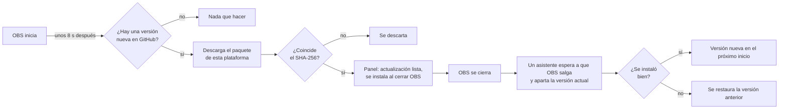

<div align="center">

# 📡 OBS Multi Stream

**Transmite una sesión de OBS a muchas plataformas a la vez, cada una desde la mezcla principal o desde su propio lienzo vertical.**

[](https://github.com/alejox/multi-streaming/releases/latest)
[](https://github.com/alejox/multi-streaming/releases)
[](LICENSE)
[](#-instalación)
[](https://obsproject.com)

**Español** | [English](README.en.md)

[⬇️ Descargar](https://github.com/alejox/multi-streaming/releases/latest) ·
[🧰 Instalar](#-instalación) ·
[✨ Funciones](#-qué-incluye) ·
[❓ Preguntas frecuentes](#-preguntas-frecuentes-y-solución-de-problemas)

</div>

---

## ✨ Qué incluye

| | Función | Qué hace |
|:-:|---------|----------|
| 🌐 | **Transmisión a varios destinos** | Muchos destinos RTMP/RTMPS, cada uno con su propio inicio y parada, más **Iniciar todos** y **Detener todos** |
| 🎯 | **Servicios predefinidos** | YouTube, Twitch, Kick, Facebook, TikTok, X, Instagram o un servidor personalizado. Enlaces a la página de la clave de transmisión de YouTube, Twitch, Kick y Facebook |
| 📱 | **Lienzo vertical** | Un segundo lienzo (1080x1920 por defecto) con sus propias escenas, fuentes, vista previa y composición Ajustar/Rellenar, en su propio panel |
| 🎞️ | **Fuente de video por destino** | Cada destino envía la mezcla `main` o el lienzo `vertical` |
| ⚙️ | **Codificadores inteligentes** | Los destinos comparten codificador cuando su configuración coincide, y usan uno dedicado cuando no |
| 🔗 | **Sincronización con la transmisión de OBS** | Opcionalmente, un destino inicia y se detiene junto con la transmisión principal de OBS |
| 🟣 | **Conectar con Twitch** | Inicio de sesión en el navegador (OAuth); la clave de transmisión se completa sola y la sesión se recuerda |
| 🔁 | **Reconexión automática** | Número de reintentos y primera espera por destino, con una cuenta atrás «siguiente intento en N s» |
| 📊 | **Estadísticas en vivo** | Tiempo al aire, bitrate y fotogramas perdidos por destino, con un aviso de «inestable» para conexiones intermitentes |
| 🛡️ | **Aislamiento de fallos** | Un destino que falla nunca detiene a los demás ni la transmisión principal |
| 🔐 | **Claves guardadas de forma segura** | Las claves viven en el Llavero de macOS, el Administrador de credenciales de Windows o el Secret Service de Linux, nunca en archivos de configuración |
| 🔄 | **Actualizaciones automáticas** | Las versiones nuevas se descargan en segundo plano, se verifican con SHA-256 y se instalan al cerrar OBS |
| 🌍 | **Traducciones** | Interfaz completa en inglés y español |
| 🎨 | **Aspecto nativo** | Sigue el tema de OBS, con un modo opcional **Iconos a color** para ver las plataformas con sus colores de marca |

---

## 🧰 Instalación

> [!IMPORTANT]
> **Cierra OBS antes de instalar.** OBS no puede reemplazar un plugin que ya cargó.

| Plataforma | Paquete | Compilado contra |
|------------|---------|------------------|
| 🍎 macOS (Apple Silicon) | `obs-multi-stream-<versión>-macos-arm64.zip` | OBS 33.0.1 |
| 🪟 Windows x64 | `obs-multi-stream-<versión>-windows-x64.zip` | OBS 33.0.1 |
| 🐧 Linux x86_64 | `obs-multi-stream-<versión>-linux-x86_64.tar.gz` | OBS del PPA para Ubuntu 24.04 (32.2.0 al momento de escribir esto) |

Todos los paquetes están en la [página de la última versión](https://github.com/alejox/multi-streaming/releases/latest). Los paquetes de Windows y Linux incluyen además sus pasos de instalación en `INSTALL.txt` (en inglés).

<details>
<summary><b>🍎 macOS (Apple Silicon, arm64)</b></summary>

<br>

1. Descarga `obs-multi-stream-<versión>-macos-arm64.zip` desde la [última versión](https://github.com/alejox/multi-streaming/releases/latest) y descomprímelo.
2. Copia el paquete `obs-multi-stream.plugin` en:

   ```text
   ~/Library/Application Support/obs-studio/plugins/
   ```

   En Finder, pulsa <kbd>⌘</kbd> <kbd>⇧</kbd> <kbd>G</kbd> y pega la ruta. Crea la carpeta `plugins` si no existe.
3. Abre OBS y comprueba [que se cargó](#-comprueba-que-se-cargó).

> [!WARNING]
> **El paquete de macOS tiene firma ad hoc y no está notarizado.** Gatekeeper puede ponerlo en cuarentena tras la descarga. Si macOS se niega a cargarlo, quita la marca:
>
> ```bash
> xattr -dr com.apple.quarantine ~/Library/Application\ Support/obs-studio/plugins/obs-multi-stream.plugin
> ```

**Desinstalar:** borra `~/Library/Application Support/obs-studio/plugins/obs-multi-stream.plugin`. Consulta [Desinstalación](#-desinstalación) para los datos que deja.

</details>

<details>
<summary><b>🪟 Windows (x64)</b></summary>

<br>

1. Descarga `obs-multi-stream-<versión>-windows-x64.zip` desde la [última versión](https://github.com/alejox/multi-streaming/releases/latest).
2. Extrae la carpeta `obs-multi-stream` en:

   ```text
   C:\ProgramData\obs-studio\plugins\
   ```

   El resultado es `C:\ProgramData\obs-studio\plugins\obs-multi-stream\`.
3. Abre OBS y comprueba [que se cargó](#-comprueba-que-se-cargó).

> [!NOTE]
> **Windows necesita OBS 33 o posterior.** OBS rechaza un plugin compilado contra una libobs más nueva que la suya.

**Desinstalar:** borra `C:\ProgramData\obs-studio\plugins\obs-multi-stream\`. Consulta [Desinstalación](#-desinstalación) para los datos que deja.

</details>

<details>
<summary><b>🐧 Linux (x86_64)</b></summary>

<br>

1. Descarga `obs-multi-stream-<versión>-linux-x86_64.tar.gz` desde la [última versión](https://github.com/alejox/multi-streaming/releases/latest).
2. Extráelo en tu carpeta de plugins de usuario:

   ```bash
   mkdir -p ~/.config/obs-studio/plugins
   tar -xzf obs-multi-stream-<versión>-linux-x86_64.tar.gz -C ~/.config/obs-studio/plugins
   ```

3. Abre OBS y comprueba [que se cargó](#-comprueba-que-se-cargó).

| Requisito | Por qué |
|-----------|---------|
| glibc 2.39 y Qt 6.4 o posterior (como en Ubuntu 24.04) | El paquete se compila en Ubuntu 24.04 |
| `libsecret` y un Secret Service en ejecución (GNOME Keyring o KWallet) | Sin él no se pueden guardar las claves de transmisión. Nunca se guardan en texto plano |

> [!NOTE]
> El PPA de OBS Project no tiene OBS 33 para Ubuntu 24.04, así que el paquete de Linux se compila contra la versión de OBS que publica el PPA. Consulta [Límites conocidos](#-límites-conocidos).

**Desinstalar:** borra `~/.config/obs-studio/plugins/obs-multi-stream/`. Consulta [Desinstalación](#-desinstalación) para los datos que deja.

</details>

### ✅ Comprueba que se cargó

| Dónde | Qué deberías ver |
|-------|------------------|
| Menú **Paneles** (Docks) | Las entradas **Multi Stream** y **Lienzo vertical** |
| **Ayuda > Archivos de registro > Ver registro actual** | Una línea con `[obs-multi-stream] loaded version` |

> [!CAUTION]
> **La primera carga modifica tu colección de escenas.** El plugin añade un lienzo llamado `obs-multi-stream-vertical`, y desinstalar el plugin no lo elimina. Consulta [Desinstalación](#-desinstalación).

---

## 🚀 Inicio rápido

Tu primera multitransmisión en tres pasos:

1. **Añade un destino.** Abre **Paneles > Multi Stream**, haz clic en **Añadir destino**, elige un servicio y pega la clave de transmisión (o haz clic en **Conectar con Twitch**).
2. **Elige el video.** Pon **Fuente de video** en `main`, o en `vertical` y organiza ese lienzo en **Paneles > Lienzo vertical**.
3. **Sal en vivo.** Pulsa el botón de inicio de la fila o **Iniciar todos**. Para seguir la transmisión principal, activa **Iniciar y detener con la transmisión de OBS** en el destino.

> [!TIP]
> El audio siempre sale de la mezcla principal. Una fuente añadida solo al lienzo vertical queda en silencio en todos los destinos, lo que evita que el audio exclusivo del vertical llegue a la transmisión principal.

---

## 🔄 Actualizaciones automáticas

El plugin se mantiene al día sin tocar un OBS en ejecución.



| El panel muestra | Significado |
|------------------|-------------|
| *Actualización X disponible* | Existe una versión más nueva |
| *Descargando la actualización X…* | El paquete se descarga en segundo plano |
| *Actualización X lista: se instala al cerrar OBS* | Verificada y preparada; cierra OBS para instalarla |
| *No se pudo buscar actualizaciones* + **Reintentar** | La comprobación falló; no se cambió nada |
| Enlace **Descargar** | Esta instalación no puede actualizarse sola; descarga el paquete desde la página de versiones |

**Desactivarlo:** abre el menú del engranaje (**Ajustes del panel**) en el panel Multi Stream y desmarca **Instalar actualizaciones automáticamente**.

> [!NOTE]
> Solo se actualizan solas las instalaciones dentro de una carpeta `obs-studio/plugins/<nombre>` con permiso de escritura (la del usuario, o `C:\ProgramData` en Windows). Las demás instalaciones, y cualquier versión que alguna vez falló al instalarse, muestran el enlace **Descargar**.

---

## 💡 Conviene saber

| Tema | Comportamiento |
|------|----------------|
| Alcance | Los destinos son globales, no por perfil de OBS |
| **Incluir en Iniciar todos** | Solo afecta a **Iniciar todos** y a la sincronización; iniciar una fila siempre funciona |
| URLs del servidor | Se rechazan las URLs con credenciales, consulta o fragmento, para que ninguna clave llegue al archivo de configuración. Si el servidor necesita una consulta, ponla en el campo de la clave |
| Configuración corrupta | Una configuración con un tipo incorrecto o un valor fuera de rango se aparta como `destinations.json.corrupt-N` y el panel lo avisa |
| Audio dedicado | AAC a 160 kbps fijos |
| Destinos sincronizados | Usan codificadores dedicados, porque OBS avisa del inicio antes de que los codificadores principales estén activos |
| Límites de reconexión | libobs fija el factor de crecimiento y el tope de 15 minutos |
| Resolución vertical | Preajustes 1080x1920, 720x1280, 1440x2560 o personalizada; no puede cambiar mientras un destino vertical está en vivo |

---

## ❓ Preguntas frecuentes y solución de problemas

<details>
<summary><b>No aparece el panel Multi Stream</b></summary>

<br>

1. Comprueba que la carpeta está en la ruta exacta de [Instalación](#-instalación) (en macOS, el propio paquete `.plugin`, no una carpeta que lo contenga).
2. Busca `[obs-multi-stream]` en el registro de OBS.
3. En macOS, quita la marca de cuarentena (ver la sección de instalación en macOS).
4. En Windows, comprueba que OBS es la versión 33 o posterior.

</details>

<details>
<summary><b>«Conectar con Twitch» no funciona</b></summary>

<br>

El inicio de sesión escucha en `http://localhost:8090/` hasta `http://localhost:8094/`, en ese orden. Cada una debe estar registrada como OAuth Redirect URL en la aplicación de Twitch en dev.twitch.tv/console. El Client ID está en `src/oauth/twitch_client_id.hpp`. El inicio de sesión expira a los 5 minutos.

</details>

<details>
<summary><b>No se puede guardar una clave en Linux</b></summary>

<br>

No hay un Secret Service en ejecución. Inicia GNOME Keyring o KWallet. El plugin falla de forma visible en lugar de recurrir al texto plano.

</details>

<details>
<summary><b>Una fuente solo del vertical no tiene sonido</b></summary>

<br>

Es intencional: el audio siempre sale de la mezcla principal. Añade la fuente de audio a la escena principal.

</details>

<details>
<summary><b>El panel solo muestra un enlace «Descargar» en lugar de actualizarse</b></summary>

<br>

La instalación está fuera de una carpeta `obs-studio/plugins/<nombre>` con permiso de escritura, o una actualización anterior falló al instalarse. Descarga el paquete desde la [última versión](https://github.com/alejox/multi-streaming/releases/latest) e instálalo a mano.

</details>

<details>
<summary><b>OBS tarda en cerrarse</b></summary>

<br>

Un servidor que nunca responde al saludo RTMP retrasa la salida unos 22 s, y la interfaz espera hasta 5 s a que las salidas se detengan al salir, al cambiar de perfil o al cambiar de colección.

</details>

---

## 🧹 Desinstalación

Quitar el plugin deja datos atrás. OBS sigue cargando sin problemas y la transmisión principal sigue funcionando con ellos.

<details>
<summary><b>Qué queda y cómo eliminarlo</b></summary>

<br>

| Residuo | Ubicación | Limpieza |
|---------|-----------|----------|
| Plugin | macOS: `~/Library/Application Support/obs-studio/plugins/obs-multi-stream.plugin`<br>Windows: `C:\ProgramData\obs-studio\plugins\obs-multi-stream\`<br>Linux: `~/.config/obs-studio/plugins/obs-multi-stream/` | Bórralo |
| Configuración y actualizaciones preparadas | macOS: `~/Library/Application Support/obs-studio/plugin_config/obs-multi-stream/`<br>Windows: `%APPDATA%\obs-studio\plugin_config\obs-multi-stream\`<br>Linux: `~/.config/obs-studio/plugin_config/obs-multi-stream/` | Bórralo |
| Lienzo y sus escenas | JSON de la colección de escenas: la entrada `canvases[]` `obs-multi-stream-vertical` y las entradas de `sources` con su `canvas_uuid` | Haz una copia del archivo y, con OBS cerrado, elimina esas entradas |
| Claves de transmisión | macOS: servicio del Llavero `com.alejox.obs-multi-stream`<br>Windows: destinos del Administrador de credenciales que empiezan por `obs-multi-stream/`<br>Linux: elementos del Secret Service con `service` = `com.alejox.obs-multi-stream` | Bórralas en Acceso a Llaveros, el Administrador de credenciales o Seahorse |

La limpieza manual de la colección se ha probado una vez.

</details>

---

## 🚧 Límites conocidos

<details>
<summary><b>Límites y estado de verificación</b></summary>

<br>

**Límites**

- La API de Canvas es oficialmente inestable en OBS 33.0.1. Las compilaciones de macOS y Windows están fijadas a esa versión; otras versiones de OBS no están probadas.
- El paquete de Linux se compila contra OBS 32.2.0, una versión no probada para una API inestable. Las funciones que llama el plugin tienen las mismas declaraciones en ambas versiones, lo que no dice nada de su comportamiento.
- Solo macOS arm64 se ha ejecutado dentro de OBS. Windows x64 y Linux x86_64 solo se compilan y pasan las pruebas unitarias en CI.
- El texto de error del Llavero, el Administrador de credenciales o el Secret Service se muestra sin traducir, tras un resumen traducido.
- Salir durante una lectura bloqueada del Llavero puede reportar fugas de memoria.
- Las actualizaciones no están firmadas y no hay canal de versiones preliminares. Una instalación tipo Program Files que necesita elevación recibe un enlace de descarga.

**Estado de verificación**

| Comprobación | Resultado |
|--------------|-----------|
| Pruebas del núcleo | ✅ 38 de 38 pasan |
| El plugin carga y descarga en OBS 33.0.1 (macOS) | ✅ Pasa |
| Transmisión principal y vertical a la vez | ✅ Pasa: 640x360 y 1080x1920 en receptores RTMP locales |
| Reintentos agotados, puerto cerrado, salir en vivo | ✅ Pasa, varias ejecuciones |
| Tres sesiones de VideoToolbox a la vez | ✅ Pasa; más sesiones sin probar |
| Script de instalación de actualizaciones (instalación, archivo dañado, estructura incorrecta, reversión) | ✅ Pasa en macOS (sh); el script de PowerShell solo se prueba como texto |
| Windows y Linux en CI: compilación, pruebas del núcleo, paquete | ✅ Pasa |
| Interfaz del panel, el editor y el lienzo vertical a mano | ⏳ Sin comprobar |
| Aviso de actualización e instalación real al cerrar | ⏳ Sin comprobar |
| Renderizador Metal | ⏳ Sin probar; todas las ejecuciones usaron OpenGL |
| Solicitud real del Llavero al iniciar | ⏳ Sin probar |
| Servicios de transmisión reales | ⏳ Sin probar; solo receptores locales |
| Windows y Linux dentro de OBS, incluidas las vistas previas en X11 y Wayland | ⏳ Sin probar |

</details>

---

## 🧑‍💻 Desarrollo

<details>
<summary><b>Arquitectura</b></summary>

<br>

El núcleo no incluye cabeceras de OBS ni de Qt, así que sus reglas se prueban sin ejecutar OBS.

| Ruta | Función |
|------|---------|
| `src/destinations/` | Núcleo: modelo, validación, códec, puertos, estadísticas, estado de sesión, plan de codificadores |
| `src/persistence/` | Repositorio atómico del archivo de configuración |
| `src/secrets/` | Adaptadores del Llavero, el Administrador de credenciales y el Secret Service, y almacenes de prueba |
| `src/streaming/` | Salidas, servicios y codificadores de libobs, sincronización con la transmisión principal |
| `src/vertical_canvas/` | Ciclo de vida del lienzo, escenas, composición, renderizado |
| `src/oauth/` | Inicio de sesión de Twitch y cliente HTTPS |
| `src/update/` | Comprobación de versiones, descarga, preparación, plan de instalación al cerrar |
| `src/dock/` | Paneles de Qt y editor |
| `src/plugin_main.cpp` | Raíz de composición |
| `tests/` | Pruebas del núcleo con CTest |

</details>

<details>
<summary><b>Compilar en macOS</b></summary>

<br>

Requiere macOS 13+, OBS 33.0.1, Xcode 26.5+ y CMake. Con OBS cerrado:

```bash
cmake --preset macos
cmake --build --preset macos
cmake --install build_macos --config RelWithDebInfo
```

</details>

<details>
<summary><b>Compilar en Linux</b></summary>

<br>

Linux compila contra los paquetes del sistema en lugar de `buildspec.json`, para que el plugin enlace la misma libobs que carga OBS. En Ubuntu 24.04:

```bash
sudo add-apt-repository ppa:obsproject/obs-studio
sudo apt-get update
sudo apt-get install --no-install-recommends \
  libsecret-1-dev libsimde-dev ninja-build obs-studio pkg-config qt6-base-dev
cmake --preset linux-x86_64
cmake --build --preset linux-x86_64
cmake --install build_linux
```

</details>

<details>
<summary><b>Pruebas</b></summary>

<br>

```bash
cmake -S tests -B build_tests
cmake --build build_tests
ctest --test-dir build_tests --output-on-failure
```

- La prueba del Secret Service se omite cuando no hay servicio disponible. Define `MULTI_STREAM_REQUIRE_SECRET_SERVICE=1` para que eso sea un fallo, como hace CI.
- Las pruebas de ejecución usan la opción de CMake `MULTI_STREAM_E2E_SECRETS` en un directorio de compilación aparte. Lee claves falsas desde un archivo y añade un gancho de comandos de prueba. Está desactivada por defecto, el código se excluye al compilar e instalar esa compilación falla a propósito.

</details>

---

## 📄 Licencia

GPL-2.0-or-later. Consulta [LICENSE](LICENSE).

- Los archivos de compilación de `cmake/` derivan de [obs-plugintemplate](https://github.com/obsproject/obs-plugintemplate); consulta [cmake/NOTICE](cmake/NOTICE).
- Los iconos de plataformas vienen de [Simple Icons](https://simple-icons.org) (CC0); consulta [data/icons/NOTICE](data/icons/NOTICE).
- El diseño aprendió de [Aitum Vertical](https://github.com/Aitum/obs-vertical-canvas) y [Multiple RTMP Outputs](https://github.com/sorayuki/obs-multi-rtmp). Este proyecto no está afiliado a ninguno de los dos.

<div align="center">

<sub>Hecho para quienes transmiten en todas partes a la vez. ⭐ Dale una estrella al repo si te resulta útil.</sub>

</div>
